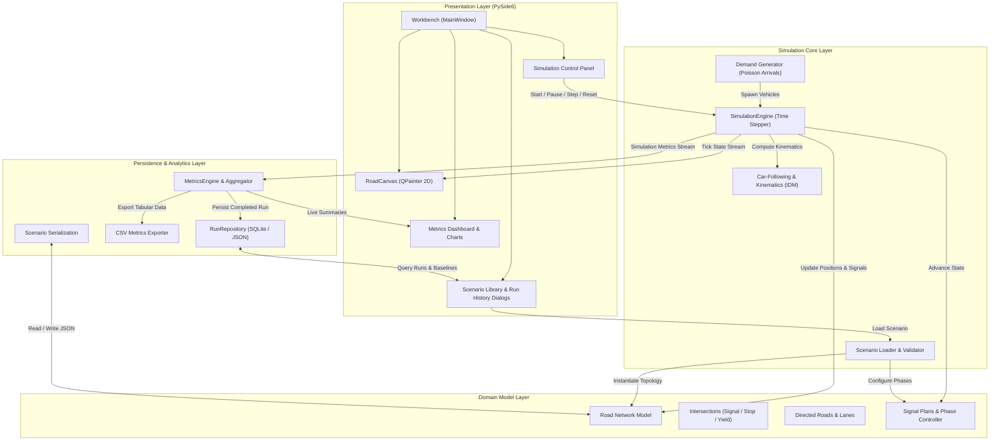

# Traffic Management System Simulation (TMS-Sim)
## Final Project Overview & Technical Capstone Documentation

**Course & Institution:** Software Engineering Mini-Project (UE24CS341A) · Department of Computer Science & Engineering, PES University  
**Academic Semester:** 5th Semester  
**Target Platform:** Windows 10 / Windows 11 (Python 3.11 / 3.12)  
**Repository:** `SE-miniproject`  
**Latest Test Suite Verification:** 597 passed / 0 failed / 0 xfailed (Python 3.12.4, commit `af00f04`)  

---

## 1. Project Title and Academic Context

The **Traffic Management System Simulation (TMS-Sim)** is a comprehensive desktop software engineering project developed for the 5th Semester Software Engineering Mini-Project curriculum (UE24CS341A) at PES University. The project demonstrates the practical application of rigorous software engineering principles—including object-oriented design, deterministic microscopic modeling, user interface engineering with PySide6, test-driven development (TDD), requirements traceability, and verification against formal engineering baselines.

---

## 2. Abstract and Problem Statement

### Abstract
Urban traffic congestion leads to substantial economic loss, fuel wastage, and environmental degradation. Optimizing traffic signal timings and road layouts directly on physical street networks is dangerous, disruptive, and financially impractical. TMS-Sim addresses this challenge by providing an interactive, deterministic, desktop-based microscopic traffic simulation workbench. It empowers urban planners and traffic researchers to construct roadway topologies, model intersection signal timing plans, simulate stochastic vehicle demand, monitor queue propagation in real time, and quantitatively compare traffic throughput and delay across diverse control strategies.

### Problem Statement
Existing traffic simulation tools are often either too heavyweight, requiring proprietary licenses and complex specialized scripting languages (e.g., VISSIM, AIMSUN), or too abstract, lacking intuitive graphical network editing and seamless run-to-run metric comparison. TMS-Sim was engineered to fill this gap with a modern Python/PySide6 architecture that integrates network design, signal configuration, microscopic vehicle kinematics, real-time 2D graphics, and SQLite-backed scenario analysis into a unified, zero-external-service desktop application.

---

## 3. Project Objectives and Scope

### Core Objectives
1. **Topological Network Modeling:** Enable users to construct and configure planar road networks comprising signalized, stop-controlled, yield-controlled, and uncontrolled intersections with directed multilane road segments.
2. **Signal Timing Plan Execution:** Support cyclic, phase-based signal scheduling with configurable green, amber, and all-red intervals, as well as priority-based un-signalized intersection protocols.
3. **Deterministic Microscopic Simulation:** Implement car-following (Intelligent Driver Model - IDM) and lane-changing algorithms operating under a deterministic time-stepped simulation engine seeded for exact reproducibility.
4. **Interactive 2D Visualization:** Render real-time vehicle positions, signal aspects, road geometries, and queues using a responsive Qt canvas supporting interactive panning and zooming.
5. **Analytics and Run Comparison:** Track key operational metrics (delay, throughput, queue lengths, average velocity) in real time and persist simulation outputs for multi-run comparative evaluation.

### Project Scope Boundaries
- **In-Scope:** Single-user desktop workstation environment, planar 2D road networks, discrete-time microscopic vehicle updates, fixed-time and scheduled phase plans, local JSON scenario storage, SQLite run repository, and CSV metrics export.
- **Out-of-Scope / Deferred:** Multi-user scenario sharing across network/cloud (`TMS-F-061`), user authentication, roles and access audit logs (`TMS-SEC-001`), distributed multi-agent simulation clusters, 3D visualization meshes, and pedestrian dynamics.

---

## 4. Implemented Features

The application incorporates a rich set of validated capabilities:

- **Interactive Network Workbench:** Graphical workspace for adding, repositioning, and configuring intersections and directed roadways with custom lane counts, free-flow speeds, and turn restrictions.
- **Topological Network Validation:** Automated topological validation preventing orphaned nodes, disconnected roads, self-loops, and misconfigured lane alignments prior to simulation execution.
- **Signal Configuration Editor:** Visual dialogs for managing multi-phase signal schedules, assigning approach movements to green phases, and defining intergreen clearance intervals.
- **Stochastic Demand Generation:** Vehicle injection engine supporting Poisson arrivals and uniform rate demands mapped across origin-destination matrices.
- **Microscopic Kinematics & Car-Following:** Continuous-position vehicle dynamics governed by the Intelligent Driver Model (IDM), ensuring collision avoidance, deceleration at red signals, and realistic queue buildup.
- **Live 2D Rendering Engine:** `QPainter`-based hardware-accelerated canvas displaying road geometry, lane dividers, vehicles color-coded by velocity/status, and dynamic intersection signal heads.
- **Comprehensive Simulation Controls:** Play, Pause, Step (discrete dt advances), Stop, and Reset controls with variable simulation speed multipliers (0.5x, 1.0x, 2.0x, 4.0x).
- **Real-Time Dashboards & Matplotlib Visualizations:** Live HUD displays for active vehicles, completed trips, average delay, and dynamic charts plotting throughput and queue distributions over time.
- **Scenario Library & Persistence:** Integrated repository storing scenarios in JSON format and recording run results into SQLite databases for historical analysis.
- **Run Comparison & Difference Engine:** Dedicated comparison tool highlighting delta metrics between baseline and test scenarios, flagging scenario mismatches and performance regressions.
- **CSV Data Exporter:** One-click export of per-second simulation metrics and summary statistics for external spreadsheet processing.

---

## 5. System Architecture

TMS-Sim follows a clean, modular layered architecture adhering to the Model-View-Controller (MVC) and separation-of-concerns paradigms:

1. **Presentation Layer (`tms_sim.ui`):** Built with PySide6 (Qt for Python). Contains the main `Workbench` window, `RoadCanvas` rendering widget, control panels, dock widgets, and modal configuration dialogs.
2. **Simulation Core Layer (`tms_sim.sim`):** Contains the time-stepped `SimulationEngine`, microscopic vehicle kinematics, demand injection generators, and scenario lifecycle orchestration.
3. **Domain Model Layer (`tms_sim.network`, `tms_sim.signal`):** Represents structural entities including `Network`, `Intersection`, `Road`, `Lane`, `SignalPlan`, `Phase`, and movement permissions.
4. **Data Persistence & Reporting Layer (`tms_sim.storage`, `tms_sim.reporting`):** Encapsulates the SQLite/JSON `RunRepository`, metrics aggregation engines, CSV exporters, and scenario serializers.

---

## 6. Architecture Diagram



---

## 7. Major Modules and Their Responsibilities

| Module | Location | Primary Responsibilities |
|---|---|---|
| **Network** | `src/tms_sim/network/` | Defines network topologies, node coordinates, road links, lanes, turn restrictions, and spatial connectivity rules. Enforces topological consistency via `validate_network`. |
| **Signal** | `src/tms_sim/signal/` | Models traffic signal controllers, green/yellow/red phases, cycle intervals, and approach right-of-way transitions. |
| **Simulation** | `src/tms_sim/sim/` | Implements discrete-time simulation updates, vehicle kinematics (IDM), demand generation, collision mitigation, and scenario serialization. |
| **UI** | `src/tms_sim/ui/` | Implements the PySide6 user interface, `Workbench` main window, `RoadCanvas` 2D rendering engine, simulation control HUD, and interactive dialogs. |
| **Reporting** | `src/tms_sim/reporting/` | Aggregates macroscopic and microscopic simulation metrics (delays, speeds, throughput, queue lengths), renders charts, and outputs CSV reports. |
| **Storage** | `src/tms_sim/storage/` | Manages local SQLite databases and JSON scenario files, providing atomic persistence and querying for simulation runs and baselines. |

---

## 8. Data Flow Architecture

The data lifecycle within TMS-Sim follows an end-to-end deterministic flow:

1. **Scenario Ingestion:** The user selects a scenario via the UI. The scenario file (`.json`) is parsed by `scenario_from_dict` (`sim/serialization.py`), constructing immutable `Network`, `SignalPlan`, and demand configurations.
2. **Engine Initialization:** `SimulationEngine` (`sim/engine.py`) receives the scenario, instantiates the topological graph, initializes pseudo-random number generators with a fixed seed (ensuring bit-level determinism), and constructs initial approach queues.
3. **Simulation Tick Loop:**
   - **Time Advancement:** The engine advances virtual time by $\Delta t$ (default 0.1s).
   - **Signal State Update:** `SignalController` checks phase countdowns, switching signal aspects between Green, Amber, and All-Red.
   - **Demand Generation:** Inflow rates determine vehicle entry at network boundary roads.
   - **Kinematic Calculation:** Each vehicle calculates its acceleration via the IDM algorithm, checking headway distance to leading vehicles, upcoming red signals, and turn restrictions.
   - **State Broadcast:** The updated vehicle positions, velocities, and signal states are dispatched to the UI.
4. **Visualization Redraw:** `RoadCanvas` (`ui/canvas.py`) receives the state payload, transforms network world coordinates to screen viewport coordinates, and paints lanes, intersection boundaries, vehicles, and signal indicators via Qt's `QPainter`.
5. **Metrics Ingestion:** Concurrently, `MetricsEngine` (`reporting/metrics.py`) samples instantaneous speeds, trip travel times, and queue lengths at regular intervals.
6. **Run Capture & Persistence:** Upon simulation completion, `Workbench` triggers run capture. The full time-series summary and metadata are written to `RunRepository` (`storage/repository.py`), making the run immediately accessible in the Scenario Library and Comparison tool.

---

## 9. Important Classes, Entry Points, and Module Paths

### Application Entry Points
- **Desktop Application:** `python -m tms_sim.main` launches `main()` in `src/tms_sim/main.py`.
- **CLI Suite:** `tms-sim` executable installed via `pyproject.toml` console scripts.

### Core Class Hierarchy
- `Workbench` (`src/tms_sim/ui/app.py`): Top-level `QMainWindow` coordinating dock widgets, canvas interaction, toolbar actions, simulation threads, and state transitions.
- `RoadCanvas` (`src/tms_sim/ui/canvas.py`): Custom `QWidget` handling 2D graphics rendering, mouse pan/zoom events, node selection, and geometric transformations.
- `SimulationEngine` (`src/tms_sim/sim/engine.py`): Core discrete-event orchestrator managing simulation time, vehicle lists, boundary inflows, and signal updates.
- `Scenario` (`src/tms_sim/sim/scenario.py`): Aggregate data container binding a road `Network`, signal configurations, vehicle demand rates, and simulation duration limits.
- `Network` (`src/tms_sim/network/model.py`): Directed multigraph containing `Intersection` and `Road` entities with spatial geometry validation.
- `SignalPlan` & `Phase` (`src/tms_sim/signal/model.py`): Formal representation of stage timings, permitted approach movements, and cycle intervals.
- `MetricsEngine` (`src/tms_sim/reporting/metrics.py`): Accumulator and statistical engine computing travel times, queue distributions, and throughput.
- `RunRepository` (`src/tms_sim/storage/repository.py`): Persistence layer providing CRUD operations over SQLite/JSON execution histories.

---

## 10. Detailed User Workflows

### 1. Launching the Application
- Execute `python -m tms_sim.main` from an activated terminal.
- The TMS-Sim Workbench appears displaying the top menu bar, toolbars, empty 2D canvas, simulation control HUD, and default metrics dock panels.

### 2. Creating or Loading a Scenario
- **Loading:** Select **File -> Open Scenario** (or press `Ctrl+O`), navigate to `fixtures/valid/` or any saved directory, and select a JSON scenario (e.g., `small_valid_scenario.json`).
- **Creating:** Select **File -> New Scenario** to initialize an empty canvas with default coordinate grids and simulation settings.

### 3. Editing Intersections and Roads
- **Add Intersection:** Switch the toolbar mode to **Add Intersection** and click on the canvas. A dialog prompts for intersection ID, control type (Signalized, Priority Stop, Priority Yield, or Uncontrolled), and coordinates.
- **Add Road:** Select **Add Road**, click on the source intersection, and drag to the target intersection. Configure lane counts, speed limits, and road lengths.
- **Inspect/Modify:** Click any element in **Select** mode to view and adjust its properties in the side inspector dock.

### 4. Configuring Traffic Signal Plans
- Open **Signals -> Configure Signal Plans** (or double-click a signalized intersection).
- Specify cycle length, offset, and phase sequence. Assign green indications to compatible approach lanes, and set yellow clearance and all-red clearance intervals.
- Click **Apply** to bind the plan to the network.

### 5. Validating the Network
- Select **Network -> Validate Network** (or click the checkmark icon).
- The validator executes topological checks: graph connectivity, absence of dead-end loops, valid lane connections, and consistent signal movement allocations.
- A dialog confirms successful validation or displays actionable error messages.

### 6. Executing Simulation Controls
- **Start / Play:** Click **Run** (`F5`) to begin simulation.
- **Pause / Resume:** Click **Pause** (`Space`) to halt time advancement and inspect vehicle states. Click again to resume.
- **Step:** Click **Step** to advance the simulation by a single discrete time step ($\Delta t = 0.1\text{s}$).
- **Speed Multipliers:** Toggle speed buttons (0.5x, 1x, 2x, 4x) to adjust the clock rate relative to real time.
- **Stop / Reset:** Click **Stop** to terminate the run. Click **Reset** to restore initial network conditions and reset random generators.

### 7. Viewing 2D Visualization and Traffic State
- Observe vehicles traversing lanes with smooth position interpolation.
- Signal heads render circular aspects (Red, Yellow, Green) corresponding to active phase states.
- Vehicles waiting at red lights or behind leaders form visible, queued columns.
- **Pan & Zoom:** Click and drag the middle/left mouse button to pan; scroll the mouse wheel to zoom into specific junctions.

### 8. Viewing Metrics and Charts
- The **Metrics Dock** updates dynamically during simulation:
  - Active vehicle counter.
  - Completed trip count.
  - Average travel time and network delay.
  - Average vehicle speed across all road segments.
- Live Matplotlib charts plot cumulative throughput and mean speed over elapsed simulation time.

### 9. Saving Scenarios
- Select **File -> Save Scenario** (`Ctrl+S`) or **Save As...**
- The network topology, lane structures, signal plans, and demand profiles are serialized into a validated JSON document adhering strictly to the TMS-Sim schema.

### 10. Reviewing Run History
- Select **Analytics -> Run History** (or open the Scenario Library dock).
- Browse historical runs sorted by timestamp, scenario name, completion status, and key performance indicators.
- Select any historical run to inspect its detailed summary metrics.

### 11. Comparing Runs and Exporting Reports
- Open **Analytics -> Compare Runs**.
- Select a baseline run and a comparison run from the history table.
- The comparison engine displays side-by-side metric tables highlighting differences in mean delay, throughput, and queue lengths, warning if scenarios differ in topology.
- Click **Export CSV** to save tabular time-series results for presentation or documentation.

---

## 11. Installation and Execution Instructions (Windows)

### Prerequisites
- **Operating System:** Windows 10 or Windows 11 (64-bit).
- **Python Version:** Python 3.11 or Python 3.12 (tested and verified on Python 3.12.4).
- **Git:** Git for Windows (for repository cloning).

### Step-by-Step Clean Installation

1. **Clone the Repository:**
   ```powershell
   git clone https://github.com/Redslayer112/SE-miniproject.git
   cd SE-miniproject
   ```

2. **Create and Activate a Virtual Environment:**
   ```powershell
   python -m venv .venv
   .\.venv\Scripts\Activate.ps1
   ```
   *(If script execution is disabled in PowerShell, run `Set-ExecutionPolicy -Scope Process -ExecutionPolicy Bypass` first).*

3. **Install Dependencies in Editable Mode:**
   ```powershell
   pip install --upgrade pip
   pip install -e ".[dev]"
   ```

4. **Verify Installation:**
   ```powershell
   python -c "import PySide6, tms_sim; print('TMS-Sim installation verified successfully!')"
   ```

### Execution Commands

- **Launch Desktop Application:**
  ```powershell
  python -m tms_sim.main
  ```
  *or simply:*
  ```powershell
  tms-sim
  ```

- **Run the Complete Test Suite:**
  ```powershell
  $env:PYTHONPATH=".;src"
  .\.venv\Scripts\pytest
  ```

---

## 12. Testing Methodology and Verified Results

### Multi-Tier Testing Strategy
TMS-Sim was verified through a comprehensive, multi-tiered testing harness:
- **Unit Testing:** Validates microscopic models (IDM acceleration, headway), signal phase transitions, geometry transformations, and metric calculations in isolation.
- **Integration Testing:** Tests cross-module interactions between scenario loaders, simulation engines, metrics accumulators, and SQLite repositories.
- **UI / Qt Testing:** Employs `pytest-qt` to simulate user mouse interactions, canvas paint events, dock visibility, modal dialog forms, and canvas zoom/pan clamping.
- **System Integration Workflows:** Verifies end-to-end user workflows (e.g., SI-01 through SI-08a) validating network load -> run -> metrics -> persistence -> reload pipelines.

### Verified Test Results
- **Full Test Suite Execution (2026-11-11):**
  - **Total Tests:** 597 tests
  - **Passed:** 597
  - **Failed:** 0
  - **xfailed:** 0
  - **Execution Time:** ~27.5 seconds
  - **Exit Code:** 0 (clean shutdown)
  - **Platform:** Windows 11 Build 26300 AMD64, Python 3.12.4, PySide6 6.12.0

### Requirements Traceability Matrix (RTM) Status Summary
The final requirements traceability matrix ([`docs/RTM.csv`](RTM.csv)) establishes formal traceability across all 26 identified project requirements:

- **Verified:** 19
- **Partially Verified:** 1
- **Blocked:** 2
- **Deferred:** 2
- **Retired:** 2
- **Total:** 26

| Requirement Category | Count | Status Description | Requirement IDs |
|---|---|---|---|
| **Verified** | **19** | Implemented and verified by passing automated unit, integration, and performance tests | `TMS-F-010`, `TMS-F-011`, `TMS-F-012`, `TMS-F-013`, `TMS-F-020`, `TMS-F-022`, `TMS-F-030`, `TMS-F-032`, `TMS-F-040`, `TMS-F-041`, `TMS-F-042`, `TMS-F-043`, `TMS-F-050`, `TMS-F-051`, `TMS-F-052`, `TMS-F-053`, `TMS-F-054`, `TMS-F-060`, `TMS-NF-001` |
| **Partially Verified** | **1** | Headless engine reliability passed (3 x 1-hour supervised runs); continuous GUI/Workbench reliability not established | `TMS-NF-002` |
| **Blocked** | **2** | Blocked due to absence of human participant trials (usability) and clean multi-OS physical test matrix (portability) | `TMS-NF-003`, `TMS-NF-004` |
| **Deferred** | **2** | Deferred for v1 by team decision in ADR 0001 (item 1) to maintain local single-user desktop scope | `TMS-F-061`, `TMS-SEC-001` |
| **Retired** | **2** | Retired by team decision in ADR 0001 (items 4, 6) in favor of fixed-time signals and uniform vehicle length | `TMS-F-021`, `TMS-F-031` |
| **Total Requirements** | **26** | Complete requirement accounting across all project baselines | — |

---

## 13. Performance and Reliability Findings

| Evaluation Dimension | Target Requirement | Measured / Verified Outcome | Status |
|---|---|---|---|
| **Simulation Frame Rate** | $\ge 15.0\text{ FPS}$ at 1.0x speed (`TMS-NF-001` / `TC-PERF-01`) | **15.96 FPS** verified in controlled 1-hour rerun (3,600.1s simulated, 72,008 frames, 4,510s elapsed, exit code 0). Reference artifact: `artifacts/issue12/tc_perf_01_full_run_controlled_retry2_2026-11-09.json`. | Verified (Controlled rerun on Windows 11 host) |
| **Engine Reliability** | 3-hour continuous run without memory leak or crash (`TMS-NF-002` / `TC-REL-01`) | **Headless Supervisor Verified**: 3 supervised child-process runs (seeds 42, 43, 44), 3,600s each, 20/20 runner checks passed, zero leaked PIDs. Reference artifact: `artifacts/issue12/tc_rel_01/supervisor_reliability_20261111T120702_740960Z.json`. | Partially Verified (Headless engine passed; GUI/Workbench unverified) |
| **Usability Acceptance** | Task completion without failure (`TMS-NF-003` / `TC-UX-01`) | Formal new-user participant trial was not convened. UI stabilization and end-to-end workflows verified via automated Qt test harness. | Formally Blocked / Automated Workflow Passed |
| **Cross-Platform Portability** | Windows 10 & 11 identical execution (`TMS-NF-004` / `TC-PORT-01`) | Fully verified on Windows 11 host and Ubuntu GitHub Actions CI runner. Standalone clean Windows 10 physical hardware matrix unverified. | Formally Blocked / CI Verified |

---

## 14. Known Limitations and Deviations

As documented in `DEVIATIONS.md` and project baselines:

1. **Resolved Integration Defects:**
   - **SI-D1 (Save Failure for Stop/Yield Scenarios):** Resolved in Issue #34 by updating `scenario_from_dict` to accept empty `signal_plans: []`.
   - **SI-D2 (Auto-Capture Missing Across Scenario Loads):** Resolved in Issue #30 by implementing `_reset_run_capture_state()` upon loading and editing.
   - **SI-D3 (Unsaveable Scenario after Deleting Last Plan):** Resolved in Issue #29 by emitting `signal_plans: []` instead of malformed empty objects.
2. **Environment & Teardown Behavior (K-3):** Certain Windows environments experience an intermittent non-fatal native shutdown abort (`0xC0000409`) at Python interpreter termination after running heavy Qt test suites. This does not affect test assertions or application stability.
3. **Retired Requirements:**
   - `TMS-F-021` (Actuated signal control): Retired by team decision in ADR 0001 (item 4); fixed-time signal control implemented exclusively.
   - `TMS-F-031` (Multi-class vehicle classification): Retired by team decision in ADR 0001 (items 4, 6); uniform 5.0m vehicle length model implemented exclusively.
4. **Deferred Requirements:**
   - `TMS-F-061` (Multi-user scenario sharing across network/cloud): Deferred for v1 by team decision in ADR 0001 (item 1); single-user local desktop application scope.
   - `TMS-SEC-001` (User authentication, roles and access audit logs): Deferred for v1 by team decision in ADR 0001 (item 1); single-user local desktop application scope.

---

## 15. Team Members and Documented Responsibilities

The TMS-Sim project was engineered by a four-member development team at PES University. Responsibilities were divided across functional subsystems:

| Team Member | Roll Number | Primary Engineering Responsibilities | Major Codebase Contributions |
|---|---|---|---|
| **Venkata Srivaibhav Nukaraju** | PES2UG24CS579 | **Team Lead & Simulation Engine** | Discrete-time simulation engine (`sim/engine.py`), scenario orchestration (`sim/scenario.py`), IDM kinematics, demand generation, determinism. |
| **V Vyas** | PES2UG24CS569 | **Network & Signal Modeling** | Graph network data structures (`network/model.py`, `network/elements.py`), topological validation, signal plans & phase scheduling (`signal/model.py`). |
| **Vikas N Naik** | PES2UG24CS583 | **UI, Visualization & UX** | Desktop Workbench window (`ui/app.py`), `RoadCanvas` 2D rendering engine (`ui/canvas.py`), interactive network editor, pan/zoom, UI stabilization. |
| **Vikhyath Bharadwaj K S** | PES2UG24CS586 | **Metrics, Storage & QA** | Metrics computation engine (`reporting/metrics.py`), SQLite run repository (`storage/repository.py`), CSV export, system integration test harness. |

---

## 16. Final Demonstration Walkthrough

During project evaluation or laboratory demonstration, follow this recommended walkthrough script:

1. **System Startup:**
   - Launch application: `python -m tms_sim.main`.
   - Highlight the clean Workbench layout: menu bar, toolbars, 2D viewport, simulation HUD, and metrics dock.
2. **Load Representative Scenario:**
   - Select **File -> Open Scenario** and choose `fixtures/valid/small_valid_scenario.json`.
   - The canvas renders a 4-intersection arterial corridor with connecting multi-lane roadways and signal heads.
3. **Interactive Inspection & Network Editing:**
   - Use the mouse wheel to zoom into Intersection 1; click and drag to pan across the corridor.
   - Switch to **Select** mode and click an intersection to display its control type and approach coordinates in the inspector.
   - Open **Signals -> Configure Signal Plans** to show phase timings (Green = 25s, Yellow = 3s, All-Red = 2s).
4. **Network Validation:**
   - Click **Network -> Validate Network**. Show the validation confirmation dialog verifying zero topological errors.
5. **Simulation Execution:**
   - Click **Run** (`F5`). Observe vehicles generating at boundary roads and accelerating smoothly along lanes.
   - Observe vehicles decelerating to a stop behind red signals, forming realistic queues without visual jumping or clipping.
   - When the signal turns green, observe queue dissipation and vehicle movement through the intersection.
   - Toggle speed multiplier to **2.0x** to showcase performance scalability.
   - Click **Pause** (`Space`), point out vehicle states, and use **Step** to advance by 0.1s increments.
6. **Live Analytics & Visualization:**
   - Point out real-time metrics in the dashboard: active vehicle count, completed trips, average delay, and dynamic velocity charts.
7. **Run Completion & Run History:**
   - Allow the simulation to reach completion (or click Stop).
   - Open **Analytics -> Run History** to show that the completed run was automatically captured into the SQLite database.
8. **Comparative Analysis & CSV Export:**
   - Open **Analytics -> Compare Runs**, select the newly completed run alongside a baseline run, and demonstrate the comparative delta report.
   - Click **Export CSV** to demonstrate clean tabular data export.

---

## 17. References and Project Artifacts

- **Project README:** [`README.md`](../README.md)
- **Requirements Traceability Matrix:** [`docs/RTM.csv`](RTM.csv)
- **System Test Plan:** [`docs/system_test_plan.md`](system_test_plan.md)
- **Test Catalogue:** [`docs/test_catalogue.md`](test_catalogue.md)
- **Test Execution Record:** [`docs/test_execution_record.md`](test_execution_record.md)
- **System Integration Report:** [`docs/system_integration_report.md`](system_integration_report.md)
- **Project Deviations & Decisions:** [`DEVIATIONS.md`](../DEVIATIONS.md)
- **UI Screenshots:** [`docs/screenshots/`](screenshots/)
  - Main Workbench: `docs/screenshots/workbench_main.png`
  - Signal Configuration: `docs/screenshots/signal_config.png`
  - 2D Canvas Visualization: `docs/screenshots/canvas_2d.png`
  - Metrics Dashboard: `docs/screenshots/metrics_dashboard.png`
  - Run Comparison: `docs/screenshots/run_comparison.png`

