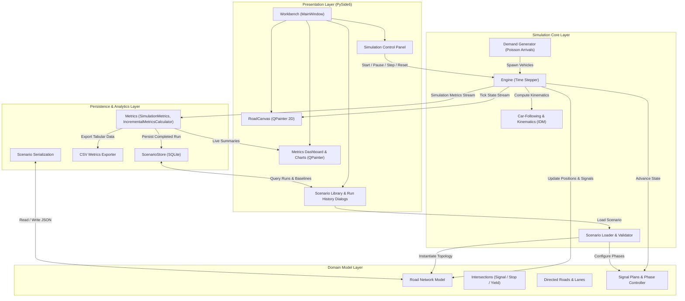

# Traffic Management System Simulation (TMS-Sim)
## Final Project Overview & Technical Capstone Documentation

**Course & Institution:** Software Engineering Mini-Project (UE24CS341A) · Department of Computer Science & Engineering, PES University  
**Academic Semester:** 5th Semester  
**Target Platform:** Windows (CI runs on `windows-latest`, Python 3.11); also runs on Linux (Python 3.14 verified offscreen)  
**Repository:** `SE-miniproject`  
**Latest Test Suite Verification:** 597 passed / 0 failed / 0 xfailed (Python 3.12.4, commit `af00f04`)  

---

## 1. Project Title and Academic Context

The **Traffic Management System Simulation (TMS-Sim)** is a comprehensive desktop software engineering project developed for the 5th Semester Software Engineering Mini-Project curriculum (UE24CS341A) at PES University. The project demonstrates the practical application of rigorous software engineering principles—including object-oriented design, deterministic microscopic modeling, user interface engineering with PySide6, test-driven development (TDD), requirements traceability, and verification against formal engineering baselines.

---

## 2. Abstract and Problem Statement

### Abstract
Urban traffic congestion leads to substantial economic loss, fuel wastage, and environmental degradation. Optimizing traffic signal timings and road layouts directly on physical street networks is dangerous, disruptive, and financially impractical. TMS-Sim addresses this challenge by providing an interactive, deterministic, desktop-based microscopic traffic simulation workbench. It empowers urban planners and traffic researchers to construct roadway topologies, model intersection signal timing plans, simulate seeded stochastic vehicle demand, monitor queue propagation in real time, and quantitatively compare traffic throughput and delay across diverse control strategies.

### Problem Statement
Existing traffic simulation tools are often either too heavyweight, requiring proprietary licenses and complex specialized scripting languages (e.g., VISSIM, AIMSUN), or too abstract, lacking intuitive graphical network editing and seamless run-to-run metric comparison. TMS-Sim was engineered to fill this gap with a modern Python/PySide6 architecture that integrates network design, signal configuration, microscopic vehicle kinematics, real-time 2D graphics, and SQLite-backed scenario analysis into a unified, zero-external-service desktop application.

---

## 3. Project Objectives and Scope

### Core Objectives
1. **Topological Network Modeling:** Enable users to construct and configure planar road networks comprising signalized, stop-controlled, yield-controlled, and uncontrolled intersections with directed road segments (one traffic stream per segment; `lane_count` is stored but the engine does not model separate lanes).
2. **Signal Timing Plan Execution:** Support cyclic, fixed-time, phase-based signal scheduling (only `green_s` phases release traffic) and gap acceptance at stop- and yield-controlled intersections (stop control is treated as yield).
3. **Deterministic Microscopic Simulation:** Implement car-following (Intelligent Driver Model, IDM) on a fixed time step. The engine contains no randomness; demand is generated from a seed, so a run is exactly reproducible. There is no lane-changing model.
4. **Interactive 2D Visualization:** Render real-time vehicle positions, signal aspects, road geometries, and queues using a Qt canvas (`QPainter`) supporting panning and zooming.
5. **Analytics and Run Comparison:** Track key operational metrics (delay, throughput, queue lengths, average velocity) in real time and persist simulation outputs for multi-run comparative evaluation.

### Project Scope Boundaries
- **In-Scope:** Single-user desktop workstation environment, planar 2D road networks, discrete-time microscopic vehicle updates, fixed-time and scheduled phase plans, versioned JSON scenario import/export, a SQLite scenario library and run store, and CSV/HTML report export.
- **Out-of-Scope / Deferred:** Multi-user scenario sharing across network/cloud (`TMS-F-061`), user authentication, roles and access audit logs (`TMS-SEC-001`), distributed multi-agent simulation clusters, 3D visualization meshes, and pedestrian dynamics.

---

## 4. Implemented Features

The application incorporates a rich set of validated capabilities:

- **Interactive Network Workbench:** Graphical workspace for adding, repositioning, and configuring intersections and directed roadways with custom lane counts, free-flow speeds, and turn restrictions.
- **Topological Network Validation:** Automated topological validation preventing orphaned nodes, disconnected roads, self-loops, and misconfigured lane alignments prior to simulation execution.
- **Signal Configuration Editor:** Visual dialogs for managing multi-phase signal schedules, assigning approach movements to green phases, and defining intergreen clearance intervals.
- **Stochastic Demand Generation:** Seeded Poisson arrivals per entry segment with turning ratios per movement. An origin-destination matrix is not implemented (`DEVIATIONS.md` row 2).
- **Microscopic Kinematics & Car-Following:** Continuous-position vehicle dynamics governed by the Intelligent Driver Model (IDM), ensuring collision avoidance, deceleration at red signals, and realistic queue buildup.
- **Live 2D Rendering Engine:** `QPainter`-based canvas (`RoadCanvas`) displaying road geometry, lane dividers, vehicles color-coded by velocity/status, and dynamic intersection signal heads.
- **Comprehensive Simulation Controls:** Play, Pause, Step (one time step) and Reset controls with variable simulation speed multipliers (0.5x, 1.0x, 2.0x, 4.0x).
- **Real-Time Dashboards & Charts:** Live displays for active vehicles, completed trips, average delay, and charts drawn with `QPainter` (`ui/charts.py`, no plotting library) showing vehicle counts, throughput and queues over time.
- **Scenario Library & Persistence:** A SQLite library (`ScenarioStore`) stores named scenarios and completed runs, each run with its own scenario snapshot; scenarios import and export as versioned JSON.
- **Run Comparison & Difference Engine:** Dedicated comparison tool highlighting delta metrics between baseline and test scenarios, flagging scenario mismatches and performance regressions.
- **CSV/HTML Exporter:** Export of a run or a comparison as CSV or an HTML report (File → Export, or the Simulation menu).

---

## 5. System Architecture

TMS-Sim follows a clean, modular layered architecture with a Qt-free simulation core and separation of concerns:

1. **Presentation Layer (`tms_sim.ui`):** Built with PySide6 (Qt for Python). Contains the `Workbench` main window and the `RoadCanvas` rendering widget (both in `ui/app.py`), charts, and the run-history, comparison and library dialogs.
2. **Simulation Core Layer (`tms_sim.sim`):** Contains the time-stepped `Engine`, IDM vehicle kinematics, the seeded demand generator, and scenario assembly (`build_engine`, `validate_scenario`).
3. **Domain Model Layer (`tms_sim.network`, `tms_sim.signal`):** Represents `Network`, intersections, road segments, turning movements, `SignalPlan` and phases, with their validators.
4. **Data Persistence & Reporting Layer (`tms_sim.storage`, `tms_sim.reporting`):** Encapsulates `ScenarioStore` (SQLite), metrics (`SimulationMetrics`, `IncrementalMetricsCalculator`), run history and comparison, CSV/HTML export, and the versioned JSON scenario serializer.

---

## 6. Architecture Diagram



---

## 7. Major Modules and Their Responsibilities

| Module | Location | Primary Responsibilities |
|---|---|---|
| **Network** | `src/tms_sim/network/` | Defines intersections, road segments, turning movements and control types, with validation (`validate`) that blocks a run on any error. |
| **Signal** | `src/tms_sim/signal/` | Models fixed-time signal plans and phases, checks them for conflicting movements, and serializes them. |
| **Simulation** | `src/tms_sim/sim/` | Implements the discrete-time `Engine` (IDM, stop lines, gap acceptance), seeded demand generation, scenario validation and versioned scenario serialization. |
| **UI** | `src/tms_sim/ui/` | Implements the PySide6 user interface: `Workbench`, `RoadCanvas`, charts, run history, comparison and library dialogs. |
| **Reporting** | `src/tms_sim/reporting/` | Computes run metrics (travel time, delay, speed, throughput, queue length), keeps run history, compares runs, and exports CSV/HTML reports. |
| **Storage** | `src/tms_sim/storage/` | `ScenarioStore`: a local SQLite library of scenarios and completed runs (save, list, load, duplicate, rename, delete, import, export). |

---

## 8. Data Flow Architecture

The data lifecycle within TMS-Sim follows an end-to-end deterministic flow:

1. **Scenario Ingestion:** The user selects a scenario via the UI. The scenario file (`.json`) is checked by `scenario_from_dict` (`sim/serialization.py`); `build_engine` (`sim/scenario.py`) then builds the `Network`, `SignalPlan`s and demand.
2. **Engine Initialization:** The network and signal services validate their input, `validate_scenario` checks demand, seed and time step, and `generate_vehicles` produces the arrival stream from the seed. `Engine` (`sim/engine.py`) receives that stream; the engine itself uses no randomness.
3. **Simulation Tick Loop:**
   - **Time Advancement:** The engine advances virtual time by one fixed step (engine default 0.5 s; each scenario sets `time_step_s` between 0.1 and 1.0 s, and the shipped fixtures use 0.1 s).
   - **Signal State Update:** Signal state comes from each movement's green function (only `green_s` releases traffic).
   - **Demand Generation:** Vehicles whose departure time has come enter at their entry segment, first-in-first-out per entry, once the entry is clear.
   - **Kinematic Calculation:** Each vehicle calculates its acceleration via the IDM algorithm, checking the gap to its leader, any stop line ahead (red signal, or no acceptable gap at a stop/yield intersection).
   - **State Broadcast:** The UI's timer calls `engine.advance()` and repaints from the engine state.
4. **Visualization Redraw:** `RoadCanvas` (`ui/app.py`) transforms network coordinates to screen coordinates and paints roads, intersections, vehicles and signal indicators with `QPainter`.
5. **Metrics Ingestion:** The engine records spawn, exit and per-step sample events; `reporting/metrics.py` turns them into travel time, delay, speed, throughput and queue metrics, and `reporting/history.py` keeps the time series.
6. **Run Capture & Persistence:** Upon simulation completion, `Workbench` triggers run capture. The run, its metrics and its scenario snapshot are written to `ScenarioStore` (`storage/store.py`), making it available in Run History and the Comparison tool.

---

## 9. Important Classes, Entry Points, and Module Paths

### Application Entry Points
- **Desktop Application:** `python -m tms_sim` (`src/tms_sim/__main__.py`).
- **Headless run:** `python -m tms_sim run SCENARIO.json` prints a run summary without the GUI.

### Core Class Hierarchy
- `Workbench` (`src/tms_sim/ui/app.py`): Top-level `QMainWindow` coordinating panels, canvas interaction, toolbar actions, the simulation timer and run capture.
- `RoadCanvas` (`src/tms_sim/ui/app.py`): Custom `QWidget` handling 2D rendering, mouse pan/zoom, selection and the editing tools.
- `Engine` (`src/tms_sim/sim/engine.py`): Fixed-step simulator holding simulation time, vehicles, stop lines and run controls (start, pause, step, reset, speed).
- `build_engine` / `engine_from_document` (`src/tms_sim/sim/scenario.py`): Assemble an `Engine` from a network, signal plans, demand and simulation settings.
- `Network` (`src/tms_sim/network/model.py`): Directed network of intersections, road segments and turning movements.
- `SignalPlan` & `Phase` (`src/tms_sim/signal/model.py`): Formal representation of stage timings, permitted approach movements, and cycle intervals.
- `SimulationMetrics` and `IncrementalMetricsCalculator` (`src/tms_sim/reporting/metrics.py`): Compute travel times, delay, queues and throughput.
- `ScenarioStore` (`src/tms_sim/storage/store.py`): SQLite persistence for scenarios and completed runs.

---

## 10. Detailed User Workflows

### 1. Launching the Application
- Execute `python -m tms_sim` from an activated terminal.
- The TMS-Sim Workbench opens with its menu bar (File, Edit, View, Simulation), the editing tools, the 2D canvas, the property and signal panels, the play controls and the metrics panels.

### 2. Creating or Loading a Scenario
- **Loading:** Select **File -> Open Scenario** (or press `Ctrl+O`), navigate to `fixtures/valid/` or any saved directory, and select a JSON scenario (e.g., `small_valid_scenario.json`).
- **Creating:** There is no "New Scenario" command. Open a sample scenario, edit it with the tools below, then use **File -> Save Scenario As...** (`Ctrl+Shift+S`). The Scenario Library (`Ctrl+L`) stores named scenarios.

### 3. Editing Intersections and Roads
- **Add Intersection:** Choose the **Add intersection** tool and click the canvas. Set its control type (signalized, stop-controlled, yield-controlled or uncontrolled) in the properties panel and press **Apply**.
- **Add Road:** Choose **Draw road**, click the source intersection, then the target intersection. Set the road's length and speed limit in the properties panel and press **Apply**.
- **Inspect/Modify:** Click any element with the **Select** tool to view and edit its properties. **Undo/Redo** (`Ctrl+Z`, `Ctrl+Y`) and **Delete selected** work on all edits.

### 4. Configuring Traffic Signal Plans
- Select a signalized intersection; the signal panel shows its plan, or offers **Create Signal Plan**.
- Use **Add Phase**, **Up/Down** and **Remove** to order the phases, choose the movements that get green, and set green, yellow and all-red times.
- Click **Apply Phase** to bind the change to the scenario.

### 5. Validating the Network
- Validation runs automatically when a scenario is loaded and after each edit; there is no separate menu command.
- The **Network Validation** panel lists every issue with its element and severity. Errors block a run; warnings do not.

### 6. Executing Simulation Controls
- **Start / Play:** Click **Play** (or press `Space`) to begin the simulation.
- **Pause / Resume:** Click **Pause** (`Space`) to halt time and inspect vehicle states; press again to resume.
- **Step:** Click **Step** (or press `S`) to advance by one time step (the scenario's `time_step_s`).
- **Speed Multipliers:** Choose 0.5x, 1x, 2x or 4x to change the clock rate relative to real time.
- **Reset:** Click **Reset** (or press `R`) to return to time zero with the same inputs; the run then replays identically.

### 7. Viewing 2D Visualization and Traffic State
- Observe vehicles moving along the roads.
- Signal heads render circular aspects (Red, Yellow, Green) corresponding to active phase states.
- Vehicles waiting at red lights or behind leaders form visible, queued columns.
- **Pan & Zoom:** Drag with the left mouse button to pan; scroll the mouse wheel to zoom into specific junctions. **View -> Reset Canvas View** (`Ctrl+R`) restores the view.

### 8. Viewing Metrics and Charts
- The **Metrics Dock** updates dynamically during simulation:
  - Active vehicle counter.
  - Completed trip count.
  - Average travel time and network delay.
  - Average vehicle speed across all road segments.
- Live charts plot vehicle counts, throughput and speed over simulation time.

### 9. Saving Scenarios
- Select **File -> Save Scenario** (`Ctrl+S`) or **Save As...**
- The network topology, lane structures, signal plans, and demand profiles are serialized into a validated JSON document adhering strictly to the TMS-Sim schema.

### 10. Reviewing Run History
- Select **Simulation -> Simulation Run History...** (`Ctrl+H`).
- Browse historical runs sorted by timestamp, scenario name, completion status, and key performance indicators.
- Select any historical run to inspect its detailed summary metrics.

### 11. Comparing Runs and Exporting Reports
- Open **Simulation -> Compare Runs...** (`Ctrl+M`).
- Select a baseline run and a comparison run from the history table.
- The comparison engine displays side-by-side metric tables highlighting differences in mean delay, throughput, and queue lengths, warning if scenarios differ in topology.
- Use **Export CSV** or **Export HTML** (also under **File -> Export**) to save the results.

---

## 11. Installation and Execution Instructions (Windows)

### Prerequisites
- **Operating System:** Windows 10 or Windows 11 (64-bit).
- **Python Version:** Python 3.11 or Python 3.12 (tested and verified on Python 3.12.4).
- **Git:** Git for Windows (for repository cloning).

### Step-by-Step Clean Installation

1. **Clone the Repository:**
   ```powershell
   git clone https://github.com/Redslayer112/SE-miniproject.git
   cd SE-miniproject
   ```

2. **Create and Activate a Virtual Environment:**
   ```powershell
   python -m venv .venv
   .\.venv\Scripts\Activate.ps1
   ```
   *(If script execution is disabled in PowerShell, run `Set-ExecutionPolicy -Scope Process -ExecutionPolicy Bypass` first).*

3. **Install Dependencies in Editable Mode:**
   ```powershell
   pip install --upgrade pip
   pip install -e ".[dev]"
   ```

4. **Verify Installation:**
   ```powershell
   python -c "import PySide6, tms_sim; print('TMS-Sim installation verified successfully!')"
   ```

### Execution Commands

- **Launch Desktop Application:**
  ```powershell
  python -m tms_sim
  ```

- **Run a Scenario Headless (no GUI):**
  ```powershell
  python -m tms_sim run tests/data/scenario/small_valid_scenario.json
  ```

- **Run the Complete Test Suite:**
  ```powershell
  python -m pytest
  ```

---

## 12. Testing Methodology and Verified Results

### Multi-Tier Testing Strategy
TMS-Sim was verified through a comprehensive, multi-tiered testing harness:
- **Unit Testing:** Validates microscopic models (IDM acceleration, headway), signal phase transitions, geometry transformations, and metric calculations in isolation.
- **Integration Testing:** Tests cross-module interactions between scenario loaders, simulation engines, metrics accumulators, and SQLite repositories.
- **UI / Qt Testing:** Drives the real Qt widgets offscreen (`QT_QPA_PLATFORM=offscreen`) with plain `pytest`, covering canvas paint calls, dialogs, editing, playback controls and zoom/pan.
- **System Integration Workflows:** Verifies end-to-end user workflows (e.g., SI-01 through SI-08a) validating network load -> run -> metrics -> persistence -> reload pipelines.

### Verified Test Results
- **Full Test Suite Execution (2026-11-11):**
  - **Total Tests:** 597 tests
  - **Passed:** 597
  - **Failed:** 0
  - **xfailed:** 0
  - **Execution Time:** ~27.5 seconds
  - **Exit Code:** 0 (clean shutdown)
  - **Platform:** Windows 11 Build 26300 AMD64, Python 3.12.4, PySide6 6.12.0
  - **Re-verified on Linux (Python 3.14, offscreen) at the same commit: 597 passed, exit code 0; 88.4% statement coverage, 86% with branch coverage combined.**

### Requirements Traceability Matrix (RTM) Status Summary
The final requirements traceability matrix ([`docs/RTM.csv`](RTM.csv)) establishes formal traceability across all 26 identified project requirements:

- **Verified:** 19
- **Partially Verified:** 1
- **Blocked:** 2
- **Deferred:** 2
- **Retired:** 2
- **Total:** 26

| Requirement Category | Count | Status Description | Requirement IDs |
|---|---|---|---|
| **Verified** | **19** | Implemented and verified by passing automated unit, integration, and performance tests | `TMS-F-010`, `TMS-F-011`, `TMS-F-012`, `TMS-F-013`, `TMS-F-020`, `TMS-F-022`, `TMS-F-030`, `TMS-F-032`, `TMS-F-040`, `TMS-F-041`, `TMS-F-042`, `TMS-F-043`, `TMS-F-050`, `TMS-F-051`, `TMS-F-052`, `TMS-F-053`, `TMS-F-054`, `TMS-F-060`, `TMS-NF-001` |
| **Partially Verified** | **1** | Headless engine reliability passed (3 x 1-hour supervised runs); continuous GUI/Workbench reliability not established | `TMS-NF-002` |
| **Blocked** | **2** | Blocked due to absence of human participant trials (usability) and clean multi-OS physical test matrix (portability) | `TMS-NF-003`, `TMS-NF-004` |
| **Deferred** | **2** | Deferred for v1 by team decision in ADR 0001 (item 1) to maintain local single-user desktop scope | `TMS-F-061`, `TMS-SEC-001` |
| **Retired** | **2** | Retired by team decision in ADR 0001 (items 4, 6) in favor of fixed-time signals and uniform vehicle length | `TMS-F-021`, `TMS-F-031` |
| **Total Requirements** | **26** | Complete requirement accounting across all project baselines | — |

---

## 13. Performance and Reliability Findings

| Evaluation Dimension | Target Requirement | Measured / Verified Outcome | Status |
|---|---|---|---|
| **Simulation Frame Rate** | $\ge 15.0\text{ FPS}$ at 1.0x speed (`TMS-NF-001` / `TC-PERF-01`) | **15.96 FPS** verified in controlled 1-hour rerun (3,600.1s simulated, 72,008 frames, 4,510s elapsed, exit code 0). Reference artifact: `artifacts/issue12/tc_perf_01_full_run_controlled_retry2_2026-11-09.json`. | Verified (Controlled rerun on Windows 11 host) |
| **Engine Reliability** | Three clean one-hour runs (`TMS-NF-002` / `TC-REL-01`) | **Headless Supervisor Verified**: 3 supervised child-process runs (seeds 42, 43, 44), 3,600s each, 20/20 runner checks passed, zero leaked PIDs. Reference artifact: `artifacts/issue12/tc_rel_01/supervisor_reliability_20261111T120702_740960Z.json`. | Partially Verified (Headless engine passed; GUI/Workbench unverified) |
| **Usability Acceptance** | Task completion without failure (`TMS-NF-003` / `TC-UX-01`) | Formal new-user participant trial was not convened. UI stabilization and end-to-end workflows verified via automated Qt test harness. | Formally Blocked / Automated Workflow Passed |
| **Cross-Platform Portability** | Windows 10 & 11 identical execution (`TMS-NF-004` / `TC-PORT-01`) | Run on a Windows 11 host and on the GitHub Actions `windows-latest` runner. Standalone clean Windows 10 physical hardware matrix unverified. | Formally Blocked / CI Verified |

---

## 14. Known Limitations and Deviations

As documented in `DEVIATIONS.md` and project baselines:

1. **Resolved Integration Defects:**
   - **SI-D1 (Save Failure for Stop/Yield Scenarios):** Resolved in PR #40 (Issue #33) by updating `scenario_from_dict` to accept empty `signal_plans: []`.
   - **SI-D2 (Auto-Capture Missing Across Scenario Loads):** Resolved in Sprint 3 (the strict xfail test now passes).
   - **SI-D3 (Unsaveable Scenario after Deleting Last Plan):** Resolved in Sprint 3 (the strict xfail test now passes) by emitting `signal_plans: []` instead of malformed empty objects.
2. **Environment & Teardown Behavior (K-3):** Certain Windows environments experience an intermittent non-fatal native shutdown abort (`0xC0000409`) at Python interpreter termination after running heavy Qt test suites. This does not affect test assertions or application stability. It is mitigated in CI by explicit Qt teardown in `tests/conftest.py` (PR #25).
3. **Retired Requirements:**
   - `TMS-F-021` (Actuated signal control): Retired by team decision in ADR 0001 (item 4); fixed-time signal control implemented exclusively.
   - `TMS-F-031` (Multi-class vehicle classification): Retired by team decision in ADR 0001 (items 4, 6); uniform 5.0m vehicle length model implemented exclusively.
4. **Deferred Requirements:**
   - `TMS-F-061` (Multi-user scenario sharing across network/cloud): Deferred for v1 by team decision in ADR 0001 (item 1); single-user local desktop application scope.
   - `TMS-SEC-001` (User authentication, roles and access audit logs): Deferred for v1 by team decision in ADR 0001 (item 1); single-user local desktop application scope.

---

## 15. Team Members and Documented Responsibilities

The TMS-Sim project was engineered by a four-member development team at PES University. Responsibilities were divided across functional subsystems:

| Team Member | Roll Number | Primary Engineering Responsibilities | Major Codebase Contributions |
|---|---|---|---|
| **Venkata Srivaibhav Nukaraju** | PES2UG24CS579 | **Team Lead & Simulation Engine** | Simulation engine (`sim/engine.py`), scenario assembly (`sim/scenario.py`), IDM kinematics, seeded demand generation (`sim/demand.py`), the SQLite scenario library (`storage/store.py`, `ui/library.py`), baseline decisions and engine stabilization. |
| **V Vyas** | PES2UG24CS569 | **Network & Signal Modeling** | Network model and validation (`network/`), signal plans, phases and conflict checks (`signal/`), scenario validation, system integration tests and report. |
| **Vikas N Naik** | PES2UG24CS583 | **UI, Visualization & UX** | Desktop `Workbench` and `RoadCanvas` (`ui/app.py`), network editing, demand and signal editors, live charts, run history, comparison dialogs, report export UI, UI stabilization. |
| **Vikhyath Bharadwaj K S** | PES2UG24CS586 | **Metrics, Storage & QA** | Run metrics (`reporting/metrics.py`), CSV export, versioned scenario serialization, CI, test plan fixtures and RTM, acceptance tests and Sprint 3 test reports. |

---

## 16. Final Demonstration Walkthrough

During project evaluation or laboratory demonstration, follow this recommended walkthrough script:

1. **System Startup:**
   - Launch application: `python -m tms_sim`.
   - Highlight the Workbench layout: menu bar, editing tools, 2D canvas, property and signal panels, play controls, and metrics panels.
2. **Load Representative Scenario:**
   - Select **File -> Open Scenario** and choose `fixtures/valid/small_valid_scenario.json`.
   - The canvas shows a small two-intersection network: one signalized intersection (I1) and one uncontrolled (I2), joined by two roads (seed 42, 600 s).
3. **Interactive Inspection & Network Editing:**
   - Use the mouse wheel to zoom in on I1; drag with the left button to pan.
   - With the **Select** tool, click an intersection to show its control type and properties.
   - Select I1 to show its signal plan in the signal panel: one phase with green 20 s, yellow 3 s, all-red 1 s.
4. **Network Validation:**
   - Show the **Network Validation** panel, which lists no errors for this scenario.
5. **Simulation Execution:**
   - Click **Play** (or press `Space`). Observe vehicles entering at the boundary road and driving along it.
   - Observe vehicles decelerating to a stop behind the red signal and forming a queue.
   - When the signal turns green, observe queue dissipation and vehicle movement through the intersection.
   - Toggle the speed multiplier to **2x** to show faster playback.
   - Click **Pause** (`Space`), point out vehicle states, and use **Step** (`S`) to advance one time step at a time.
6. **Live Analytics & Visualization:**
   - Point out the live metrics: active vehicle count, completed trips, average delay, and the charts.
7. **Run Completion & Run History:**
   - Allow the simulation to reach completion (expected for the shipped scenario: 30 vehicles completed, mean travel time 16.4 s).
   - Open **Simulation -> Simulation Run History...** to show that the completed run was captured into the SQLite database.
   - Press **Reset** before each further run so every run is captured.
8. **Comparative Analysis & CSV Export:**
   - Open **Simulation -> Compare Runs...**, select the new run alongside a baseline run, and show the comparison.
   - Click **Export CSV** to demonstrate the export.

---

## 17. References and Project Artifacts

- **Project README:** [`README.md`](../README.md)
- **Requirements Traceability Matrix:** [`docs/RTM.csv`](RTM.csv)
- **Test Plan (v1.1):** [`docs/Test_Plan_v1.1.pdf`](Test_Plan_v1.1.pdf)
- **Test Case Document:** [`docs/test_case_document.md`](test_case_document.md)
- **Test Catalogue:** [`docs/test_catalogue.md`](test_catalogue.md)
- **Test Execution Record:** [`docs/test_execution_record.md`](test_execution_record.md)
- **System Integration Report:** [`docs/system_integration_report.md`](system_integration_report.md)
- **Project Deviations & Decisions:** [`DEVIATIONS.md`](../DEVIATIONS.md)
- **UI Screenshots:** [`docs/screenshots/`](screenshots/)
  - Main Workbench: `docs/screenshots/01_main_workbench.png`
  - Network editing: `docs/screenshots/02_network_editing_interface.png`
  - 2D visualization: `docs/screenshots/03_2d_network_visualization.png`
  - Live vehicle movement: `docs/screenshots/04_live_vehicle_movement.png`
  - Signal states and queues: `docs/screenshots/05_signal_states_and_queues.png`
  - Metrics dashboard and charts: `docs/screenshots/06_metrics_dashboard_and_charts.png`

